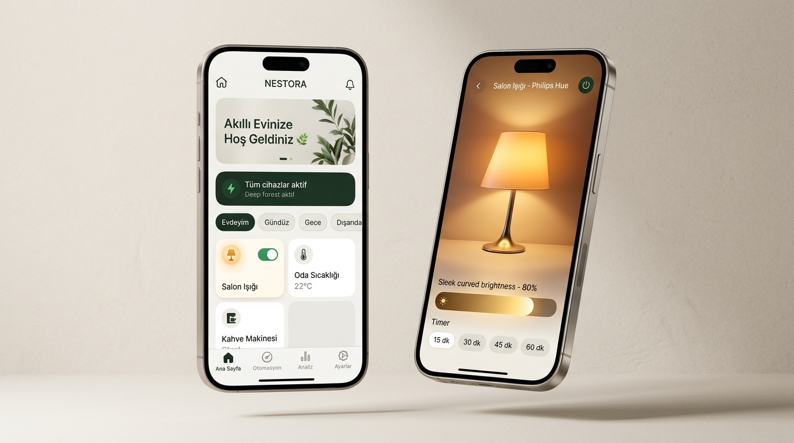
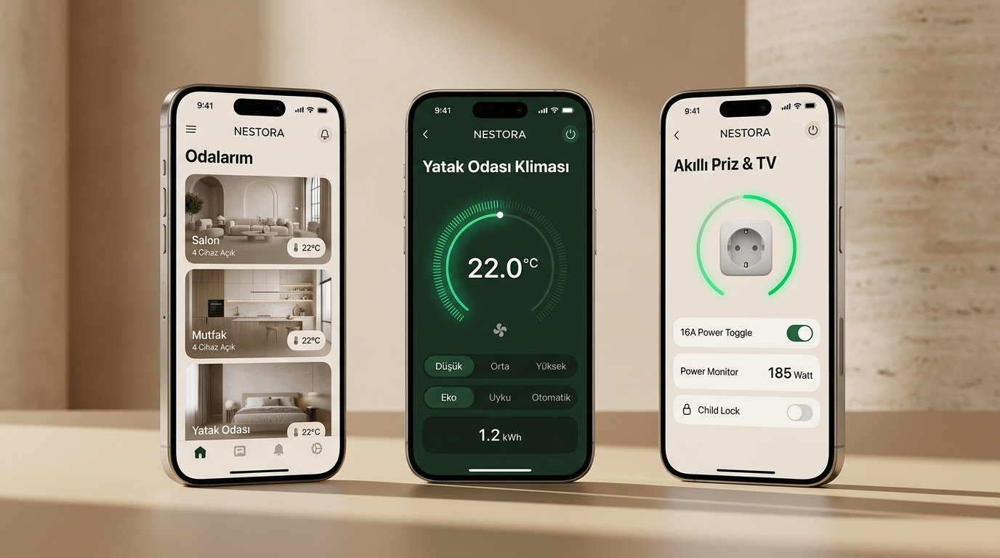
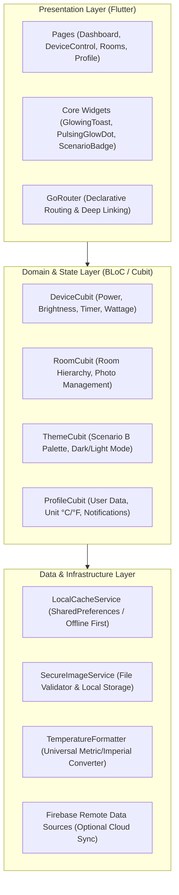
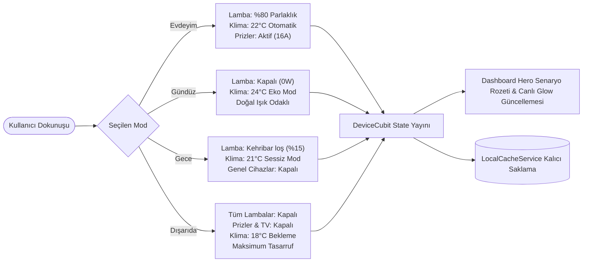
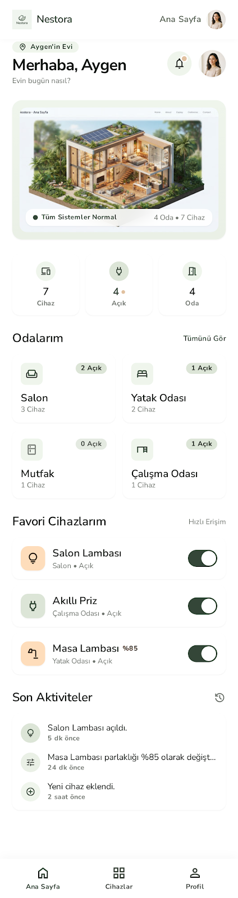
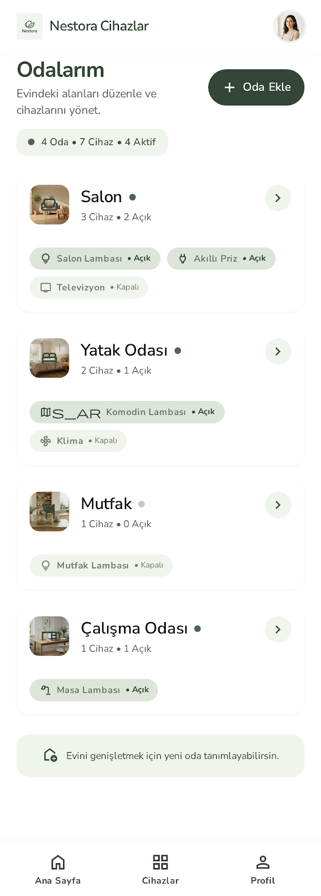
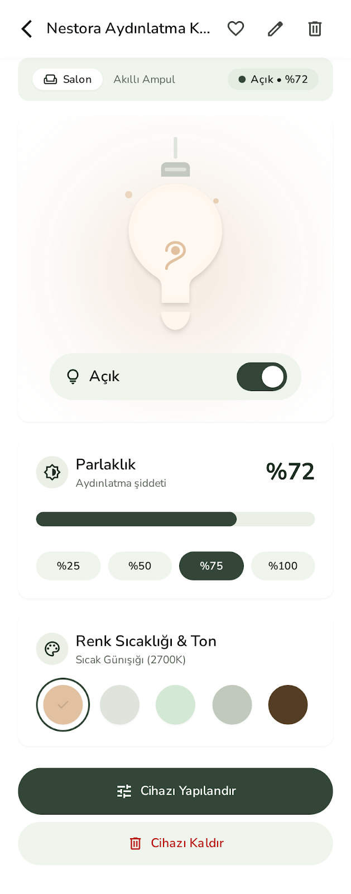
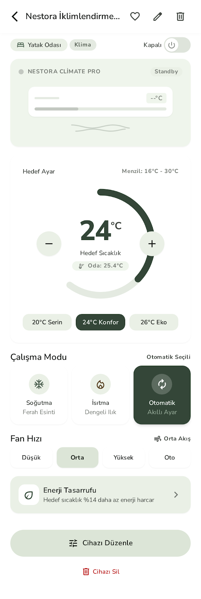
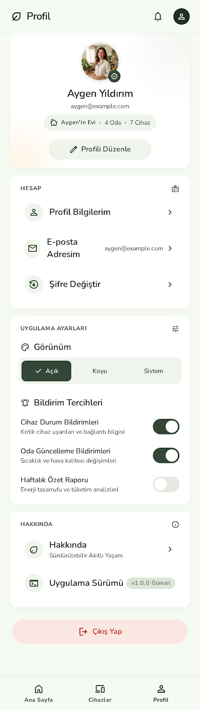

# NESTORA — Modern & Sürdürülebilir Akıllı Yaşam Ekosistemi

<div align="center">


### *Evinizin Dinginliği ile Teknolojinin Zarafeti Arasındaki Kusursuz Denge*

[](https://flutter.dev)
[](https://dart.dev)
[](https://bloclibrary.dev)
[](#-yazılım-mimarisi--teknoloji-yığını)
[-success?style=for-the-badge&logo=checkmarx&logoColor=white)](#-testler--kalite-güvencesi)
[](#-testler--kalite-güvencesi)
[](#-tasarım-sistemi--senaryo-b-modern-kaşmir--doğal-taş)
[](LICENSE)

<br/>

[](assets/screens/nestora_ios_mockup_showcase.jpg)

> *"Teknolojiyi evinize dayatan değil; yaşam alanınızın huzuruna ve doğal ritmine kusursuzca karışan akıllı ev deneyimi."*

</div>

---

## 📑 İçindekiler
- [🌟 Neden NESTORA? — Ürün Vizyonu ve Hikayesi](#-neden-nestora--ürün-vizyonu-ve-hikayesi)
- [🎯 Kimler İçin Tasarlandı?](#-kimler-için-tasarlandı)
- [⚔️ Geleneksel Akıllı Ev Sistemleri ile Karşılaştırma](#️-geleneksel-akıllı-ev-sistemleri-ile-karşılaştırma)
- [📱 Temel Özellikler & İnteraktif Deneyim](#-temel-özellikler--interaktif-deneyim)
- [🎨 Tasarım Sistemi: Senaryo B ("Modern Kaşmir & Doğal Taş")](#-tasarım-sistemi-senaryo-b-modern-kaşmir--doğal-taş)
- [🏗️ Yazılım Mimarisi & Teknoloji Yığını](#️-yazılım-mimarisi--teknoloji-yığını)
- [📊 Veri Akışı & Senaryo Durum Makinesi](#-veri-akışı--senaryo-durum-makinesi)
- [📁 Dosya & Dizin Yapısı](#-dosya--dizin-yapısı)
- [🚀 Hızlı Başlangıç & Kurulum](#-hızlı-başlangıç--kurulum)
- [🔒 Güvenlik Politikası & Çevre Değişkenleri](#-güvenlik-politikası--çevre-değişkenleri)
- [🧪 Testler & Kalite Güvencesi](#-testler--kalite-güvencesi)
- [📸 Ekran Görüntüleri Galerisi](#-ekran-görüntüleri-galerisi)
- [🗺️ Yol Haritası (Roadmap)](#️-yol-haritası-roadmap)
- [📄 Lisans & Yazar](#-lisans--yazar)

---

## 🌟 Neden NESTORA? — Ürün Vizyonu ve Hikayesi

### Problem: Akıllı Evler Neden "Soğuk ve Karmaşık"?
Piyasadaki popüler akıllı ev uygulamalarının çoğu mühendisler tarafından mühendisler için tasarlanmıştır. Kullanıcılar evlerine girdiklerinde:
1. **Ruhsuz & Endüstriyel Tasarımlar:** Koyu mavi/neon tonlar, fabrika otomasyon panellerini andıran grafikler ve kullanıcının oturma odasındaki sıcaklığı yansıtmayan soğuk arayüzler.
2. **Kademeli Menü Yorgunluğu:** Basit bir lambayı kısmak veya uyku öncesi salonu kapatmak için 4-5 menü derinliğine inmek zorunda kalmak.
3. **Bulut Bağımlılığı & Gizlilik Kaygısı:** İnternet bağlantısı kesildiğinde donanımların erişilemez hale gelmesi veya hassas kamera/oda verilerinin denetimsiz sunuculara akması.
4. **Hissiyatsız Anahtarlar:** Gerçek donanımın durumunu yansıtmayan, sıradan dijital açma/kapama anahtarları.

### Çözüm: NESTORA’nın Felsefesi
**NESTORA**, akıllı evi mekanik bir makine değil, insanla birlikte nefes alan **organik bir yaşam alanı** olarak ele alır. İskandinav sadeliği ile biofilik mimarinin sakinleştirici doğallığını harmanlayan **Senaryo B ("Modern Kaşmir & Doğal Taş")** paletini temel alır.

- **Sıfır Çaba İlkesi:** 1 dokunuşla tüm evi ayarlayan senaryolar (Evdeyim, Gündüz, Gece, Dışarıda).
- **Hissedilebilir Etkileşim:** Lamba açıldığında arayüzdeki sanal ampulün çevresine yayılan yumuşak amber ışık aurası; kahve demlerken fincandan yükselen buhar animasyonu; klima çarkında hissedilen hassas 0.5°C kademeleri.
- **Local-First & Sıfır Veri Sızıntısı:** Bulut kapalıyken bile kesintisiz çalışan yerel önbellek (`LocalCacheService`) ve hardcoded API anahtarı barındırmayan sıfır sızıntılı güvenlik omurgası.

---

## 🎯 Kimler İçin Tasarlandı?

| Kullanıcı Profili | Karşılaşılan Sorun | NESTORA’nın Sağladığı Kolaylık |
| :--- | :--- | :--- |
| **Estetik & Tasarım Tutkunları** | Evin şık dekorasyonu ile uyuşmayan çirkin, endüstriyel mobil arayüzler. | **Doğal Taş & Kaşmir** renkleri, mimari oda görselleri ve göze batmayan premium tipografi. |
| **Eko & Enerji Bilinçli Bireyler** | Hangi cihazın ne kadar tükettiğini bilmemek, açık unutulan prizler. | Gerçek zamanlı **Watt ölçümü**, tek dokunuşla **Gündüz / Dışarıda tasarruf modları** ve haftalık eko bildirimler. |
| **Zamanına Değer Veren Aileler** | Evden çıkarken veya yatarken tek tek 15 lambayı ve klimayı kapatma zahmeti. | **Tek Tık Senaryo Motoru** ve lambalarda **15/30/45/60 dk otomatik geri sayım sayaçları**. |
| **Gizlilik & Güvenlik Arayanlar** | Sürekli veri toplayan ticari bulut çözümleri ve sızan API anahtarları. | **Yerel önbellekleme**, sandbox doğrulamalı güvenli resim yükleyici (`SecureImageService`) ve sıfır izleyici. |

---

## ⚔️ Geleneksel Akıllı Ev Sistemleri ile Karşılaştırma

```
  Geleneksel Uygulamalar (Soğuk, Menü Odaklı) ────┐
                                                 ├──►  NESTORA Farkı: Dingin, Hızlı, Yaşayan Arayüz
  NESTORA (Biofilik, Kaşmir, Tek Dokunuş)    ────┘
```

| Özellik / Deneyim Kriteri | Apple Home | Google Home | Tuya / Smart Life | 🌿 NESTORA |
| :--- | :---: | :---: | :---: | :---: |
| **Tasarım Felsefesi** | Düz kutular | Kart yığını | Endüstriyel şablon | **Biofilik Kaşmir & Doğal Taş (Senaryo B)** |
| **Ana Ekran Senaryo Hızı** | 2-3 Dokunuş | 2 Dokunuş | Karmaşık kurallar | **Tek Tık Hero Senaryo Rozeti** |
| **Lamba Ambiyans Simülasyonu** | Basit renk dairesi | Statik gösterge | Kuru slider | **Dinamik Glow Aurası & Kapanma Sayacı** |
| **Kahve / TV / Priz İnteraktivitesi** | Sadece On/Off | Sadece On/Off | Basit toggle | **TV Ses/Kanal, Kahve Sertlik, Priz Çocuk Kilidi** |
| **Çevrimdışı / Demo Hazırlığı** | Kısmi | Düşük | Yok (Hata verir) | **Tamamen Kesintisiz Local-First Mimari** |
| **Sıcaklık Birimi Senkronizasyonu** | Sistem geneli | Menü içi | Cihaz başı | **Evrensel Dinamik °C / °F Çevirici** |
| **Test Kapsamı & Kararlılık** | Kapalı kaynak | Kapalı kaynak | Değişken | **428 Otomatik Test (%100 Başarı)** |

---

## 📱 Temel Özellikler & İnteraktif Deneyim

[](assets/screens/nestora_ios_features_showcase.jpg)

### 1. Akıllı Ev Senaryoları & Hero Canlı Rozet
Ana sayfanın en üstünde konumlanan **Hero Senaryo Kartı**, evin anlık durumunu canlı bir atmosfer ikonu, pulsing glow rozeti ve çalışan cihaz sayısıyla özetler:
- 🏡 **Evdeyim:** Yaşam alanları aydınlatmaları konfor seviyesine (%80), klima 22.0°C otomatik moda ve temel prizler aktif konuma geçer.
- ☀️ **Gündüz:** Gün ışığından azami verim almak için ana aydınlatmalar kapatılır (0W), klima 24.0°C eko moduna alınır.
- 🌙 **Gece:** Tüm genel ışıklar söndürülür; yatak odası loş gece lambası sıcak kehribar tonuna (%15, 2200K) geçer, klima 21.0°C sessiz moda çekilir.
- 🚶 **Dışarıda:** Evdeki tüm lambalar, televizyon ve prizler tek hamlede kapatılır; klima 18.0°C bekleme moduna geçer (Maksimum enerji tasarrufu).

### 2. Donanım Seviyesinde İnteraktif Kontrol Panelleri
NESTORA'da hiçbir cihaz sıradan bir açma/kapama kutucuğundan ibaret değildir:
- 💡 **Salon Lambası (`LampControlPage`):** Seçilen parlaklık seviyesine göre ekranın merkezindeki ampul figürü fiziksel olarak ışık yayar. Sıcak Günışığı, Doğal Beyaz, Sıcak Sarı, Yumuşak Yeşil ve Gece Mavisi atmosfer renk modları tek tıkla seçilebilir. **15, 30, 45, 60 dakikalık gerçek geri sayım zamanlayıcısı** ile uyku öncesi otomatik kapanır.
- ❄️ **Yatak Odası Kliması (`AcControlPage`):** 0.5°C adımlı hassas sıcaklık tekerleği, Düşük/Orta/Yüksek fan seviyeleri, Eko/Uyku/Otomatik modları ve anlık kWh enerji sayacı.
- 🔌 **Akıllı Priz (`PlugControlPage`):** 16A manyetik röle anahtarı, anlık çekilen güç monitörü (**185 Watt**), çocuk emniyet kilidi ve zaman ayarlı otomatik kapatma.
- ☕ **Akıllı Kahve Makinesi (`CoffeeMachineControlPage`):** Tek/Çift Espresso, Americano, Latte seçenekleri, 3 kademeli kahve sertliği ve demleme esnasında canlanan buhar animasyonu.
- 📺 **Oturma Odası Televizyonu (`TvControlPage`):** Gerçekçi TV ekran çerçevesi, ses kontrol slider'ı, favori kanal butonları ve HDMI 1/2/3 giriş seçimi.

### 3. Mimari Odalar & Güvenli Resim Seçici
- Salon, Mutfak, Yatak Odası, Çalışma Odası ve Banyo için yüksek çözünürlüklü modern mimari fotoğraflar.
- **`SecureImageService`:** Kullanıcının galerisinden seçtiği resimler için format doğrulaması (yalnızca JPG/PNG), dosya boyutu optimizasyonu ve yerel güvenli dizinde kalıcı saklama.
- Masaüstü ve mobilde kusursuz çalışan esnek oda ekleme/düzenleme akışı.

### 4. Akıllı Mikro Etkileşimler
- ✨ **`GlowingToast`:** Standart sıkıcı uyarılar yerine, ekranın altında önce parıldayan, ardından yumuşakça sönen doğal taş tonlu yüzen bilgilendirme kartı.
- 🟢 **`PulsingGlowDot`:** Çalışan cihazların yanında nefes alan canlı yeşil durum halkası.
- 🔔 **Eko-Enerji Bildirimleri:** Profil ayarlarından haftalık rapor açıldığında sisteme anında düşen detaylı tasarruf analizi.

---

## 🎨 Tasarım Sistemi: Senaryo B ("Modern Kaşmir & Doğal Taş")

NESTORA, uzun ekran sürelerinde gözü yormayan, iç mimarideki doğal kireçtaşı ve sıcak kaşmir tekstillerinden ilham alan özel bir tasarım diline sahiptir.

<div align="center">

| Renk Rolü | Hex Kodu | Önizleme | Kullanım Alanı |
| :--- | :---: | :---: | :--- |
| **Arka Plan (Canvas)** | `#F5F3EF` | `████████` | Ana sayfa ve sayfa zeminleri, doğal taş beji |
| **Kartlar & Konteynerler** | `#FFFFFF` | `████████` | İçerik kartları, dialoglar ve modal zeminleri |
| **İkincil Yüzeyler** | `#EAE6DF` | `████████` | Rozetler, pasif butonlar, çip filtreleri |
| **Vurgu & Birincil Eylem** | `#1E3023` | `████████` | Ana eylem butonları, derin orman yeşili |
| **Başlıklar & Tipografi** | `#1C1C1E` | `████████` | Yüksek kontrastlı ana başlıklar (Manrope) |
| **Gövde Metinleri** | `#6B6B70` | `████████` | Açıklama ve alt yazılar |
| **Aktif Durum & Glow** | `#C5A880` | `████████` | Kehribar sıcak ışık aurası ve zamanlayıcı çipleri |

</div>

---

## 🏗️ Yazılım Mimarisi & Teknoloji Yığını

NESTORA, kurumsal ölçekte test edilebilirliği ve sürdürülebilirliği garanti altına alan **Feature-First Clean Architecture** prensiplerine sadık kalınarak inşa edilmiştir.



### Mühendislik Bileşenleri
- **UI Framework:** Flutter 3.47+ (Dart 3.13+)
- **Durum Yönetimi:** `flutter_bloc` / `cubit` (Predictable, test edilebilir tek yönlü veri akışı)
- **Yönlendirme:** `go_router` (Tip güvenli deklaratif navigasyon)
- **Servis Bulucu (DI):** `get_it` (Hafif ve gevşek bağlı bağımlılık enjeksiyonu)
- **Çevrimdışı Depolama:** `LocalCacheService` (Kalıcı durum, anında başlangıç)
- **Güvenli Dosya İçi:** `SecureImageService` (I/O doğrulaması ve yerel kopya saklama)
- **Tipografi:** Google Fonts (`Manrope` geometrik sans-serif)

---

## 📊 Veri Akışı & Senaryo Durum Makinesi

Bir kullanıcı hızlı eylemlerden bir senaryoyu seçtiğinde sistemdeki cihaz durumlarının nasıl dönüştüğü aşağıdaki durum makinesinde modellenmiştir:



---

## 📁 Dosya & Dizin Yapısı

```
lib/
├── app/
│   ├── di/
│   │   └── injection.dart            # GetIt bağımlılık enjeksiyon konteyneri
│   ├── router/
│   │   └── app_router.dart           # GoRouter deklaratif rotaları ve rota korumaları
│   └── theme/
│       ├── app_colors.dart           # Senaryo B renk sabitleri (#F5F3EF, #1E3023, vb.)
│       └── app_theme.dart            # Material 3 açık ve koyu tema tanımları
├── core/
│   ├── services/
│   │   ├── local_cache_service.dart  # Çevrimdışı önbellekleme ve kalıcı durum servisi
│   │   └── secure_image_service.dart # Doğrulamalı ve güvenli oda resmi yöneticisi
│   ├── utils/
│   │   └── temperature_formatter.dart# °C <-> °F evrensel sıcaklık formatlayıcı
│   └── widgets/
│       ├── glowing_toast.dart        # Yumuşak parıldayan mikro-toast bildirimi
│       ├── pulsing_glow_dot.dart     # Canlı yeşil donanım kalp atışı göstergesi
│       └── nestora_button.dart       # Orman yeşili birincil eylem butonu
└── features/
    ├── auth/                         # Splash (4 sn), Hoş Geldiniz, Giriş Yap, Kayıt Ol
    ├── home/                         # Dashboard, Hero senaryo rozeti, enerji kartları
    ├── rooms/                        # Odalarım, Mimari oda kartları, Oda Detay, Oda Ekle
    ├── devices/                      # Cihaz listesi, Arama/Filtreleme, TV/Priz/Kahve/Lamba/Klima
    ├── notifications/                # Bildirim merkezi, tarih gruplama, eko raporlar
    └── profile/                      # Profil ayarları, avatar seçici, °C/°F, Hakkında modalı
```

---

## 🚀 Hızlı Başlangıç & Kurulum

### Ön Gereksinimler
- **Flutter SDK:** `>= 3.3.0` (Önerilen: 3.47+)
- **Dart SDK:** `>= 3.0.0`
- **İşletim Sistemi:** iOS 14+, Android 8.0+, macOS, Windows 10/11 veya Web

### 1. Projeyi Klonlayın
```bash
git clone https://github.com/Aygen5/NESTORA.git
cd NESTORA
```

### 2. Bağımlılıkları İndirin
```bash
flutter pub get
```

### 3. Demo / Çevrimdışı Modda Başlatın
NESTORA, herhangi bir harici bulut ayarı gerektirmeksizin **tam donanımlı sanal cihazlar ve odalarla** anında çalışmaya hazırdır:
```bash
flutter run
```

---

## 🔒 Güvenlik Politikası & Çevre Değişkenleri

NESTORA, **Sıfır Sabit Kodlu Sır (Zero Hardcoded Secrets)** politikasına göre inşa edilmiştir. Kaynak kod içerisinde hiçbir Google API anahtarı, Firebase token'ı veya üçüncü parti gizli anahtar barındırılmaz.

### Canlı Firebase Ortamı Yapılandırması
Canlı Firebase veritabanı veya kimlik doğrulama sunucusuna bağlanmak için anahtarlar derleme esnasında güvenle enjekte edilir:

```bash
flutter run \
  --dart-define=FIREBASE_WEB_API_KEY=YOUR_WEB_API_KEY \
  --dart-define=FIREBASE_ANDROID_API_KEY=YOUR_ANDROID_API_KEY \
  --dart-define=FIREBASE_IOS_API_KEY=YOUR_IOS_API_KEY
```

> [!NOTE]
> Örnek çevre değişkeni tanımları için kök dizindeki [`.env.example`](.env.example) dosyasına göz atabilirsiniz.

---

## 🧪 Testler & Kalite Güvencesi

Proje, kurumsal seviyede dayanıklılık sağlamak adına **428 adet otomatikleştirilmiş birim, cubit ve widget testi** ile korunmaktadır.

```bash
# Tüm test paketini koşturun (428 test, 0 failure)
flutter test

# Statik kod analizi (0 warnings, 0 errors)
flutter analyze
```

```
00:18 +428: All tests passed!
No issues found! (ran in 3.2s)
```

### Test Mimarisi Odakları:
- **BLoC / State Transition Testleri:** Senaryo değişimlerinde tüm cihazların beklenen moda geçişinin doğrulanması.
- **İnteraktif Kontroller:** Lamba zamanlayıcısının geri sayımı, TV ses slider'ı, kahve sertlik butonları.
- **Evrensel Sıcaklık Dönüştürücü:** °C ve °F arasındaki matematiksel tutarlılık ve yuvarlama testleri.
- **Yerel Önbellek & Güvenlik:** Cache anahtarlarının bütünlüğü ve resim formatı doğrulama sınırları.

---

## 📸 Ekran Görüntüleri Galerisi

<div align="center">

| 1. Karşılama (Onboarding) | 2. Ana Dashboard | 3. Odalarım (Mimari) |
| :---: | :---: | :---: |
|  |  |  |

<br/>

| 4. Salon Lambası Kontrolü | 5. Klima & Enerji | 6. Profil & Tercihler |
| :---: | :---: | :---: |
|  |  |  |

</div>

---

## 🗺️ Yol Haritası (Roadmap)

- [x] **Faz 1:** Core Cubit Durumlarının Çevrimdışı Başlatılması & LocalCacheService
- [x] **Faz 2:** Senaryo B ("Modern Kaşmir & Doğal Taş") Renk Paleti ve Glowing Bileşenler
- [x] **Faz 3:** TV, Akıllı Priz, Kahve Makinesi ve Salon Lambası Dinamik Işık Kontrolleri
- [x] **Faz 4:** Mimari Oda Yönetimi, Güvenli Resim Yükleme ve Oda Ekleme Akışı
- [x] **Faz 5:** Profil, Dinamik Sıcaklık Dönüştürücü (°C/°F), Eko Bildirimler & Test Paketi
- [x] **Güvenlik Sertleştirmesi:** GitHub Secret Scanning temizliği, MIT Lisansı & 3D iOS Vitrini
- [ ] **Gelecek Sürüm (v3.0):** Matter & Thread IoT Protokol Adaptörü
- [ ] **Gelecek Sürüm (v3.1):** Apple Watch / Wear OS Widget Desteği & Siri Kestirmeleri

---

## 📄 Lisans & Yazar

Bu proje [MIT Lisansı](LICENSE) altında lisanslanmıştır. Açık kaynak standartlarına uygun olarak özgürce incelenebilir, çatallanabilir ve geliştirilebilir.

**Geliştirici & Tasarımcı:** [Aygen Yıldırım](https://github.com/Aygen5)  
**Proje Adı:** NESTORA Smart Living Platform  
**Telif Hakkı:** &copy; 2026 Aygen Yıldırım. Tüm hakları saklıdır.

<div align="center">
  <sub>Modern akıllı ev teknolojisinin huzurlu yüzü ile tanışın. 🌿</sub>
</div>
