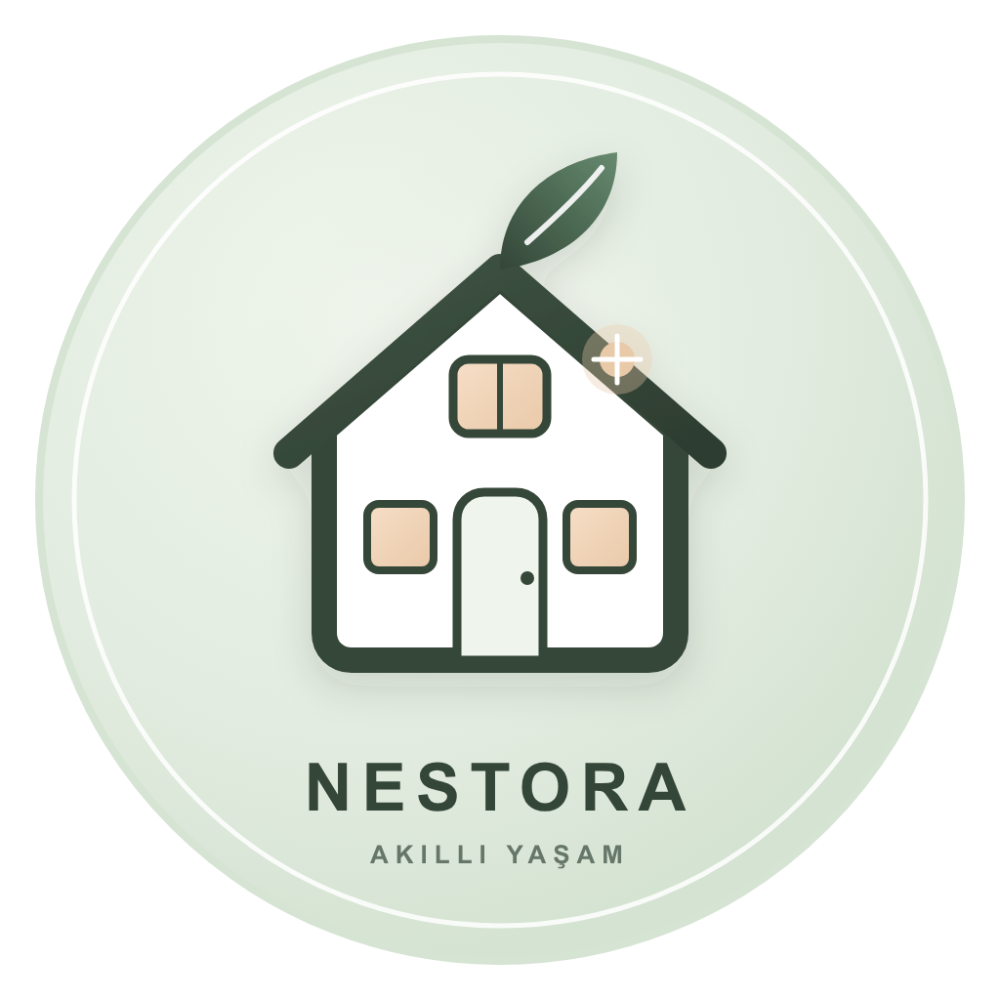
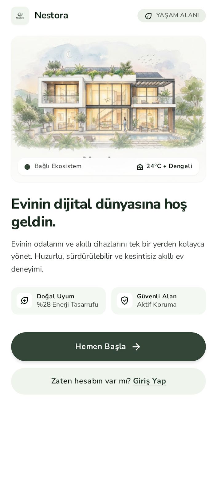
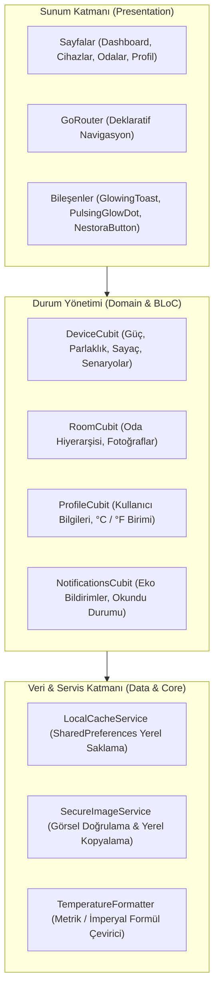

# NESTORA — Akıllı Ev Yönetim Platformu

<div align="center">



### *Flutter ile Geliştirilmiş Sade, Fonksiyonel ve Modern Akıllı Ev Uygulaması*

[](https://flutter.dev)
[](https://dart.dev)
[](https://bloclibrary.dev)
[](#-yazılım-mimarisi--teknik-detaylar)
[-success?logo=checkmarx&logoColor=white)](#-testler--kalite-güvencesi)
[](#-testler--kalite-güvencesi)
[](LICENSE)

<br/>



</div>

---

## 📑 İçindekiler
- [📖 Uygulama Hakkında](#-uygulama-hakkında)
- [✨ Temel Özellikler & Günlük Kullanım](#-temel-özellikler--günlük-kullanım)
- [💡 Neden Tercih Edilmeli? (Fark Yaratan Yönleri)](#-neden-tercih-edilmeli-fark-yaratan-yönleri)
- [🏗️ Yazılım Mimarisi & Teknik Detaylar](#️-yazılım-mimarisi--teknik-detaylar)
- [📁 Dosya ve Klasör Düzeni](#-dosya-ve-klasör-düzeni)
- [🚀 Kurulum ve Çalıştırma](#-kurulum-ve-çalıştırma)
- [🔒 Güvenlik & Ortam Değişkenleri](#-güvenlik--ortam-değişkenleri)
- [🧪 Testler & Kalite Güvencesi](#-testler--kalite-güvencesi)
- [📄 Lisans](#-lisans)

---

## 📖 Uygulama Hakkında

**NESTORA**, evdeki akıllı cihazları, odaları ve günlük yaşam senaryolarını tek bir mobil arayüz üzerinden sade, anlaşılır ve hızlı bir şekilde yönetmek amacıyla Flutter ile geliştirilmiş bir akıllı ev uygulamasıdır.

Uygulamanın geliştirilme amacı; akıllı ev yönetimini karmaşık menülerden kurtarıp kullanıcının kapıdan girerken veya uyumaya giderken tek bir dokunuşla tüm evi ayarlayabilmesini sağlamaktır. Aşırı karmaşık veya gereksiz animasyonlar yerine, gerçekten çalışan ve günlük hayatı pratikleştiren özelliklere odaklanılmıştır.

### Kimler İçin Uygundur?
- **Evini Tek Merkezden Yönetmek İsteyenler:** Lambalar, klima, televizyon, priz ve kahve makinesi gibi farklı cihazları ayrı ayrı uygulamalar açmak yerine tek ekranda toplamak isteyen kullanıcılar.
- **Hızlı ve Pratik Kullanım Arayanlar:** Cihazları tek tek kapatmak yerine "Dışarıda" veya "Gece" gibi hazır senaryolarla tek dokunuşta işlem yapmak isteyenler.
- **Çevrimdışı ve Güvenli Çalışma İsteyenler:** Harici sunuculara veya sürekli internete bağımlı kalmadan, yerel önbellek ile anında çalışan bir demo altyapısı ve veri gizliliği arayanlar.

---

## ✨ Temel Özellikler & Günlük Kullanım

### 1. Hızlı Eylemler (Akıllı Ev Senaryoları)
Dashboard'un en üstünde yer alan senaryo düğmeleri, tek bir dokunuşla birden fazla cihazın durumunu senkronize eder:
- 🏡 **Evdeyim:** Yaşam alanındaki lambaları %80 konfor seviyesine çeker, klimayı 22°C otomatik moda getirir ve prizleri açık konuma alır.
- ☀️ **Gündüz:** Gün ışığından yararlanmak için aydınlatmaları kapatır (0 Watt) ve klimayı 24°C eko moda alır.
- 🌙 **Gece:** Ana aydınlatmaları söndürür, yatak odası gece lambasını loş (%15) moda alır ve klimayı 21°C sessiz çalışma moduna geçirir.
- 🚶 **Dışarıda:** Tüm lambaları, televizyonu ve prizleri kapatır; klimayı 18°C bekleme moduna çekerek maksimum enerji tasarrufu sağlar.
- **Hero Senaryo Rozeti:** O an hangi senaryonun aktif olduğunu ve kaç cihazın açık olduğunu ana ekranda anlık olarak gösterir.

### 2. Cihazlara Özel Kontrol Ekranları
Her cihaz türü için genel bir anahtarın ötesinde, o cihaza özgü ayarlar geliştirilmiştir:
- 💡 **Salon Lambası (`LampControlPage`):** Parlaklık ayar slider'ı, renk sıcaklığı modları (Sıcak Günışığı, Doğal Beyaz, Gece Mavisi vb.) ve **15, 30, 45, 60 dakikalık gerçek geri sayım zamanlayıcısı**. Süre dolduğunda lamba otomatik olarak kapatılır.
- ❄️ **Klima (`AcControlPage`):** 0.5°C hassasiyetli sıcaklık ayar çarkı, fan seviyeleri (Düşük, Orta, Yüksek) ve Eko/Uyku/Otomatik modları.
- 🔌 **Akıllı Priz (`PlugControlPage`):** Anlık güç tüketim monitörü (Watt), 16A açma/kapama rölesi, çocuk emniyet kilidi ve zaman ayarlı kapatma.
- ☕ **Kahve Makinesi (`CoffeeMachineControlPage`):** Fincan boyutu seçimi (Tek/Çift Espresso, Americano, Latte), kahve sertliği seçeneği ve demleme başlatma kontrolü.
- 📺 **Televizyon (`TvControlPage`):** Güç düğmesi, ses seviyesi göstergesi/sliderı, favori kanal butonları ve HDMI giriş seçim paneli.

### 3. Oda Yönetimi
- Salon, Mutfak, Yatak Odası, Çalışma Odası ve Banyo kategorileri.
- Ana ekrandan hızlıca yeni oda tanımlama (+ Oda Ekle) ve oda detayından aktif cihazları filtreleyebilme.
- Güvenli resim seçici (`SecureImageService`) ile kullanıcının kendi galerisinden güvenli uzantı/boyut kontrolleriyle oda resmi atayabilmesi.

### 4. Profil ve Kişisel Tercihler
- **Sıcaklık Birimi Seçimi:** Profil üzerinden seçilen °C veya °F birimi, `TemperatureFormatter` aracılığıyla ana sayfa, oda detayları ve klima kontrolleri dahil tüm uygulamada otomatik olarak dönüştürülür.
- **Profil Fotoğrafı:** İsteğe bağlı olarak galeriden fotoğraf yükleme, varsayılan kadın avatarına dönme veya fotoğrafı tamamen kaldırarak baş harfli avatar kullanma seçeneği.
- **Haftalık Özet Raporu:** Ayar açıldığında enerji tasarruf bildiriminin bildirim merkezine düşmesi.

---

## 💡 Neden Tercih Edilmeli? (Fark Yaratan Yönleri)

Piyasada pek çok akıllı ev uygulaması bulunmaktadır. NESTORA'nın tercih edilmesini sağlayacak somut özellikler şunlardır:

1. **Çevrimdışı ve Anında Çalışan Mimari (Local-First):**  
   Uygulama, ilk açılışında herhangi bir harici bulut hesabına veya sunucuya ihtiyaç duymadan hazır sanal cihazlar ve odalarla anında tam fonksiyonel çalışır. Yapılan tüm durum değişiklikleri `LocalCacheService` ile yerel cihaz hafızasında kalıcı olarak saklanır.
2. **Karmaşıklıktan Uzak, Düz Arayüz:**  
   Bir cihazı açmak veya senaryo seçmek için iç içe klasörlerde kaybolmazsınız. Hızlı eylemler ana ekranın merkezindedir.
3. **Gerçek Zamanlayıcılar ve Geri Bildirimler:**  
   Örneğin lamba sayacında seçilen süre (15/30/45/60 dk) arka planda gerçek bir zamanlayıcı çalıştırır ve süresi dolduğunda cihazı fiziksel olarak kapatır; ekranda da parıldayan `GlowingToast` kartı ile anlık net bilgilendirme yapılır.
4. **Sade ve Göz Yormayan Tasarım:**  
   Aşırı parlak veya neon renkler yerine, doğal taş ve açık kaşmir tonları (`#F5F3EF`), koyu mod desteği ve okunabilir Manrope tipografisi tercih edilmiştir.
5. **Yüksek Test Güvencesi:**  
   Projedeki tüm akışlar 428 adet otomatikleştirilmiş test ile doğrulanmış olup, bozuk veya çalışmayan hiçbir sahte buton barındırmaz.

---

## 🏗️ Yazılım Mimarisi & Teknik Detaylar

NESTORA, sürdürülebilir ve test edilebilir bir yapı sunan **Feature-First Clean Architecture** prensiplerine göre yapılandırılmıştır.



### Kullanılan Başlıca Kütüphaneler:
- **`flutter_bloc` / `bloc`:** Durum yönetimi ve tek yönlü tahmin edilebilir veri akışı.
- **`go_router`:** Tip güvenli rota ve sayfa yönlendirmeleri.
- **`get_it`:** Gevşek bağlı (loosely-coupled) bağımlılık enjeksiyonu.
- **`shared_preferences`:** Yerel durum ve tercihlerin kalıcı saklanması.
- **`image_picker`:** Cihaz galerisinden görsel seçimi.
- **`google_fonts`:** Manrope ve modern tipografi desteği.

---

## 📁 Dosya ve Klasör Düzeni

```
lib/
├── app/
│   ├── di/
│   │   └── injection.dart            # GetIt bağımlılık enjeksiyon yapılandırması
│   ├── router/
│   │   └── app_router.dart           # GoRouter deklaratif rotaları
│   └── theme/
│       ├── app_colors.dart           # Renk paleti sabitleri (#F5F3EF, #1E3023, vb.)
│       └── app_theme.dart            # Açık ve koyu tema tanımları
├── core/
│   ├── services/
│   │   ├── local_cache_service.dart  # Durum ve tercihleri yerel hafızada tutan servis
│   │   └── secure_image_service.dart # Görsel boyutu ve formatını doğrulayan servis
│   ├── utils/
│   │   └── temperature_formatter.dart# °C <-> °F dinamik dönüştürücü
│   └── widgets/
│       ├── glowing_toast.dart        # Yumuşak parıldayan toast bilgilendirme bileşeni
│       └── pulsing_glow_dot.dart     # Canlı durum gösterge halkası
└── features/
    ├── auth/                         # Splash (4 sn), Hoş Geldiniz, Giriş Yap, Kayıt Ol
    ├── home/                         # Dashboard, Hızlı Eylemler, Hero senaryo rozeti
    ├── rooms/                        # Odalarım, Oda Detayı, Oda Ekleme akışı
    ├── devices/                      # Cihaz arama/filtreleme, TV, Priz, Kahve, Lamba, Klima kontrolleri
    ├── notifications/                # Bildirimler ekranı, tarih gruplaması, haftalık rapor bildirimi
    └── profile/                      # Profil ayarları, avatar seçici, birim seçimi, Hakkında modalı
```

---

## 🚀 Kurulum ve Çalıştırma

### Sistem Gereksinimleri
- **Flutter SDK:** `>= 3.3.0` (Önerilen: 3.47+)
- **Dart SDK:** `>= 3.0.0`
- **Hedef Platformlar:** Android, iOS, Windows, macOS, Web

### 1. Projeyi Bilgisayarınıza Klonlayın
```bash
git clone https://github.com/Aygen5/NESTORA.git
cd NESTORA
```

### 2. Gerekli Paketleri Yükleyin
```bash
flutter pub get
```

### 3. Uygulamayı Başlatın (Varsayılan Demo Modu)
Herhangi bir yapılandırma gerekmeksizin hazır cihazlar ve odalarla anında çalışır:
```bash
flutter run
```

---

## 🔒 Güvenlik & Ortam Değişkenleri

Projede hiçbir hassas Google API anahtarı veya servis parolası kod içerisine gömülü (hardcoded) olarak bırakılmamıştır.

Canlı Firebase entegrasyonu kullanılmak istendiğinde anahtarlar derleme anında `--dart-define` ile dışarıdan güvenle verilir:

```bash
flutter run \
  --dart-define=FIREBASE_WEB_API_KEY=your_web_key \
  --dart-define=FIREBASE_ANDROID_API_KEY=your_android_key \
  --dart-define=FIREBASE_IOS_API_KEY=your_ios_key
```

Şablon çevre değişkenleri için kök dizindeki [`.env.example`](.env.example) dosyası referans alınabilir.

---

## 🧪 Testler & Kalite Güvencesi

Projede "çalışmayan hiçbir özellik yer almamalıdır" prensibi benimsenmiş olup, **428 adet otomatikleştirilmiş test** bulunmaktadır.

```bash
# Tüm test paketini koşturma (428 test)
flutter test

# Kod analizi ve kural kontrolü (0 sorun)
flutter analyze
```

```
00:23 +428: All tests passed!
No issues found! (ran in 3.4s)
```

---

## 📄 Lisans

Bu proje [MIT Lisansı](LICENSE) kapsamında lisanslanmıştır.

**Telif Hakkı:** &copy; 2026 Aygen Yıldırım. Tüm hakları saklıdır.
