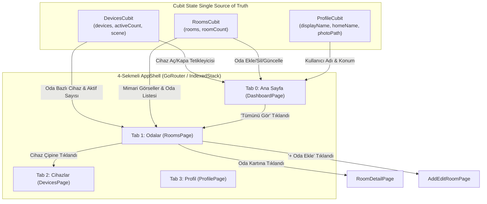

# NESTORA — Radikal Dashboard & Odalarım Yenilenmesi Planı (Plan 2)

Bu plan; kullanıcının paylaştığı ekran görüntüleri (Image 1, Image 2, Image 3 ve Image 4) ve detaylı gereksinimleri doğrultusunda **Ana Sayfa (Dashboard)**, **Odalarım (Rooms)** ve **Uygulama Alt Gezinme Kabuğu (4-Sekmeli AppShell)** üzerinde yapılacak köklü görsel ve işlevsel revizyonları tanımlar.

---

## 🎯 1. Hedefler ve Değişimin Felsefesi

1. **Görsel Bütünlük ve Doğruluk:**
   - Kod tabanımızda yer alan orijinal izometrik modern villa görseli (`assets/screens/modern_smart_house.jpg`) Dashboard merkezine yerleştirilecektir.
   - 3. ekran görüntüsündeki zarif selamlama, sistem durumu, 3'lü özet sayaçlar ve 2x2 oda kartları; 1. ve 2. ekran görüntüsündeki canlı Aktif Senaryo rozeti, Hızlı Eylemler ve Aktif Cihazlar ızgarası ile tek bir akıcı ekranda birleştirilecektir.
2. **"Ekranda Görünen Her Şey Gerçekten Çalışmalı" İlkesi:**
   - 3 yuvarlak istatistik rozetindeki sayılar (`Cihaz`, `Açık`, `Oda`) kesinlikle statik/hardcoded olmayacak; `DevicesCubit` ve `RoomsCubit` durumlarına tam bağlı çalışacaktır.
   - Bir cihaz kapatıldığında `Açık` sayısı ve odanın sağ üstündeki `$X Açık` rozeti anında düşecek; yeni bir oda eklendiğinde `Oda` sayısı anında artacaktır.
3. **4-Sekmeli Kabuk (AppShell) Mimarisi:**
   - Uygulama alt gezinme çubuğu 4 sekmeye çıkarılacaktır:
     - `0: Ana Sayfa` (Revize Dashboard)
     - `1: Odalar` (Image 4'teki tam liste ve yönetim ekranı)
     - `2: Cihazlar` (Tüm cihazlar, filtreleme ve arama)
     - `3: Profil` (Kişisel ayarlar, tema, birim ve Hakkında)
   - Dashboard'da `Odalarım` başlığı yanındaki `Tümünü Gör` tıklandığında doğrudan `Odalar` sekmesine (Tab 1) geçilecektir.
4. **Tasarım Sistemi Korunumu:**
   - Onaylanmış **Senaryo B ("Modern Kaşmir & Doğal Taş")** renk paleti (`#F5F3EF`, `#1E3023`, `#EAE6DF`, `#FFFFFF`), Manrope tipografisi, `GlowingToast` ve `PulsingGlowDot` bileşenleri aynen korunacaktır.

---

## 📸 2. Ekran Görüntüleri Karşılaştırma ve Analiz Matrisi

| Görsel No | Kaynak / Amaç | Dashboard / Odalar Entegrasyon Rolü |
| :--- | :--- | :--- |
| **Görsel 1** | Mevcut Dashboard Üst Kısmı | 76px Üst Bar (Logo, Favoriler, Bildirimler, Avatar), **Aktif Senaryo Rozeti** (`Aktif Senaryo: Evdeyim [6 açık]`), ve **Hızlı Eylemler** (`Evdeyim`, `Gündüz`, `Gece Modu`, `Dışarıda`) korunacaktır. |
| **Görsel 2** | Mevcut Dashboard Alt Kısmı | **Aktif Cihazlar** (`6 cihaz açık`) 2 sütunlu cihaz kartları ızgarası (Lamba parlaklık, TV durumu, Priz Watt göstergesi) sayfanın alt bölümünde korunacaktır. |
| **Görsel 3** | Yeni Dashboard Tasarım Referansı | `📍 Aygen'in Evi` konum etiketi, `Merhaba, Aygen` ve `Evin bugün nasıl?` başlığı, `assets/screens/modern_smart_house.jpg` ev görseli ve altındaki `● Tüm Sistemler Normal • 4 Oda • 7 Cihaz` çubuğu, **3'lü yuvarlak özet rozet** (`7 Cihaz`, `4 Açık •`, `4 Oda`) ve **2x2 Odalarım kartları** (`Salon`, `Yatak Odası`, `Mutfak`, `Çalışma Odası` + `$X Açık` rozetleri). *(Not: Favori cihazlarım ve son aktiviteler kullanıcının isteğiyle hariç tutulmuştur).* |
| **Görsel 4** | Yeni Odalarım Sekmesi Referansı | 4. sekme olarak çalışacak `Odalarım` sayfası: Başlık, açıklama, `+ Oda Ekle` butonu, `● 4 Oda • 7 Cihaz • 4 Aktif` durum çubuğu, mimari fotoğraflı dikey oda kartları, oda içi cihaz durum çipleri (`💡 Salon Lambası • Açık`, vb.) ve alt bilgi kartı. |

---

## 🏗️ 3. Mimari Bileşenler ve Veri Akışı

---

## 📋 4. Adım Adım Uygulama Planı (Fazlar)

### Faz A: Uygulama Kabuğu (AppShell) ve Alt Gezinme Çubuğu (4 Sekme)
- [x] **A.1:** `lib/core/widgets/nestora_bottom_nav.dart` bileşenine 4. sekme (`Odalar`) entegrasyonu:
  - 0: `Ana Sayfa` (`Icons.home_outlined` / `Icons.home`)
  - 1: `Odalar` (`Icons.meeting_room_outlined` / `Icons.meeting_room`)
  - 2: `Cihazlar` (`Icons.grid_view_outlined` / `Icons.grid_view`)
  - 3: `Profil` (`Icons.person_outline` / `Icons.person`)
- [x] **A.2:** `lib/app/app_shell.dart` içerisinde `pages` listesine `RoomsPage`'in 1. index olarak eklenmesi; `_calculateSelectedIndex` ve `_onItemTapped` yönlendirmelerinin 4 sekmeye göre güncellenmesi.
- [x] **A.3:** `lib/app/router/app_router.dart` rota eşlemelerinin `/rooms` rotasını Shell tab olarak destekleyecek şekilde doğrulanması.

### Faz B: Dashboard — Karşılama, Villa Görseli ve Sistem Durumu
- [ ] **B.1:** `DashboardPage` üst karşılama bloğunun (Image 3) inşası:
  - Konum rozeti: `📍 ${profile.homeName}` (`Aygen'in Evi`)
  - Ana başlık: `Merhaba, $userFirstName`
  - Alt başlık: `Evin bugün nasıl?`
- [ ] **B.2:** Modern Villa Görsel Kartı (`_buildHouseIllustrationCard`):
  - `assets/screens/modern_smart_house.jpg` görselinin 20px yuvarlatılmış köşeli, zarif gölgeli kart olarak yerleştirilmesi.
  - Görselin alt kısmına entegre yarı-şeffaf durum çubuğu:
    - Sol: `● Tüm Sistemler Normal` (canlı yeşil `PulsingGlowDot` ile)
    - Sağ: `$totalRooms Oda • $totalDevices Cihaz` dinamik sayaçları.

### Faz C: Dashboard — Aktif Senaryo & 3'lü Canlı İstatistik Rozetleri
- [ ] **C.1:** Aktif Senaryo Kartı (Image 1):
  - `Aktif Senaryo: $activeScenario` ve yanında `[$activeDeviceCount açık]` hapı.
  - Seçilen senaryonun açıklaması ve renk ikonu (`_getScenarioAccentColor`, `_getScenarioIcon`).
- [ ] **C.2:** 3'lü Yuvarlak İstatistik Rozetleri (Image 3):
  - Kart 1: Cihaz ikonu (`Icons.devices_other_rounded`), kalın `$totalDevices` rakamı, `Cihaz` alt yazısı.
  - Kart 2: Priz ikonu (`Icons.power_rounded`), kalın `$activeDeviceCount` rakamı (yanında yeşil/kehribar canlı nokta), `Açık` alt yazısı.
  - Kart 3: Kapı/oda ikonu (`Icons.door_sliding_rounded`), kalın `$totalRooms` rakamı, `Oda` alt yazısı.
  - *Doğrulama:* `DevicesCubit` veya `RoomsCubit` değiştiğinde anında tetiklenen reaktif yapı.

### Faz D: Dashboard — Hızlı Eylemler, 2x2 Odalarım Izgarası ve Aktif Cihazlar
- [ ] **D.1:** Hızlı Eylemler Barı (Image 1):
  - `Evdeyim`, `Gündüz`, `Gece Modu`, `Dışarıda` hap butonları.
  - Tıklandığında senaryonun uygulanması, `GlowingToast` bildirimi ve cihazların senkronizasyonu.
- [ ] **D.2:** 2x2 Odalarım Izgarası (Image 3):
  - Başlık: `Odalarım`
  - Sağda: `Tümünü Gör` butonu $\rightarrow$ Tıklandığında `onNavigateToRooms()` ile Tab 1 (`Odalar`) sekmesine geçiş.
  - 2 sütun x 2 satır grid (ilk 4 oda: Salon, Yatak Odası, Mutfak, Çalışma Odası):
    - Sol üstte: Oda ikonu
    - Sağ üstte: `$roomActiveCount Açık` durum hapı
    - Sol altta: Oda Adı (kalın)
    - Altında: `$roomDevicesCount Cihaz`
    - Karta tıklandığında: `RoomDetailPage` sayfasına geçiş.
- [ ] **D.3:** Aktif Cihazlar Bölümü (Image 2):
  - Başlık: `Aktif Cihazlar` ve `$activeDeviceCount cihaz açık` rozeti.
  - Salon Lambası, Televizyon, Akıllı Priz ve Masa Lambası 2 sütunlu kartları; anlık toggle ve ilgili kontrol sayfasına (`LampControlPage`, vb.) yönlendirme.

### Faz E: Odalarım Sekmesi (RoomsPage) Dönüşümü (Image 4)
- [ ] **E.1:** Sayfa başlığı: `Odalarım`, alt başlık: `Evindeki alanları düzenle ve cihazlarını yönet.`
- [ ] **E.2:** Sağ üstte koyu yeşil `+ Oda Ekle` butonu (`AddEditRoomPage(isEditing: false)` açar).
- [ ] **E.3:** Özet bilgi hapı: `● $totalRooms Oda • $totalDevices Cihaz • $activeDevices Aktif`.
- [ ] **E.4:** Dikey Mimari Oda Kartları:
  - Sol tarafta yuvarlatılmış mimari oda fotoğrafı thumbnail'i (`assets/rooms/...`) ve oda ikonu.
  - Oda adı + yeşil aktiflik noktası (`roomActiveCount > 0` ise).
  - Altında: `$roomDevicesCount Cihaz • $roomActiveCount Açık`.
  - Sağda: `>` ok butonu (`RoomDetailPage` açar).
  - Kart içi alt çipler: Odanın cihazları (`💡 Salon Lambası • Açık`, `🔌 Akıllı Priz • Açık`, `📺 Televizyon • Kapalı`). Tıklandığında o cihazın kontrol ekranına geçiş.
- [ ] **E.5:** En altta çağrı kartı: `🏠+ Evini genişletmek için yeni oda tanımlayabilirsin.` (tıklandığında `AddEditRoomPage` açar).

### Faz F: Test Güvencesi & Regresyon Doğrulaması
- [ ] **F.1:** Mevcut 428 testin `AppShell` 4-sekme ve yeni `DashboardPage` hiyerarşisiyle uyumlu hale getirilmesi.
- [ ] **F.2:** Yeni 3'lü özet sayaçları, 2x2 oda grid'i, `Tümünü Gör` sekme geçişi ve Image 4 oda kartları için kapsamlı widget testlerinin yazılması.
- [ ] **F.3:** `flutter analyze` (0 issue) ve `flutter test` (%100 pass) doğrulaması.

---

## 🔒 5. Güvenlik ve Kurallar Taahhüdü

1. **Çalışmayan Hiçbir Özellik Olmayacak:** Tüm butonlar, sayaçlar, kartlar ve çipler ya bir duruma etki edecek ya da ilgili sayfaya navigasyon sağlayacaktır.
2. **Sahte / Temsili Veri Yok:** Rakamlar ve durumlar doğrudan `DevicesCubit` ve `RoomsCubit` durumlarından dinamik beslenecektir.
3. **Dokümantasyon Bütünlüğü:** Tüm adımlar tamamlandıkça `docs/plan_2.md` üzerinde işaretlenecek ve raporlanacaktır.

